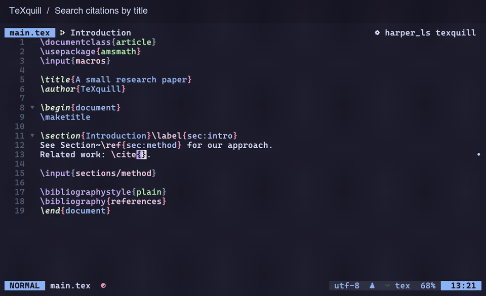

# TeXquill

A LaTeX language server written in Rust, with completion, navigation, rename, formatting, builds, and diagnostics.

[Getting started](docs/install.md) · [VS Code extension](editors/vscode/README.md) · [Documentation](docs/README.md) · [Benchmarks](docs/benchmarks.md) · [MIT license](LICENSE)

Version 1.0.0 supports precompiled downloads from GitHub Releases for Linux x64/ARM64, Apple Silicon macOS, and Windows x64, plus installation through Cargo, a Homebrew tap, and the repository's Nix flake once the corresponding release is published. See [installation](docs/install.md) for commands and availability, and [release maintenance](docs/releasing.md) for publishing instructions.

Search a citation by title, preview the paper, and insert its key—all inside Neovim.

[Watch the demos](docs/demos.md): citation completion, cross-file navigation and rename, quick fixes, linked environment editing, macro documentation, formatting, builds, and source/PDF forward and reverse search. [Download this clip](docs/public/demos/completion.mp4).

The documentation website can be previewed locally with `npm ci` and `npm run docs:dev`. See [website maintenance](docs/documentation.md) for production builds and GitHub Pages setup.

## LSP support and comparison with texlab

Reviewed on 2026-10-26. TeXquill reflects the implementation in this repository; [texlab](https://github.com/latex-lsp/texlab) reflects `master` at commit [`94e6c09`](https://github.com/latex-lsp/texlab/tree/94e6c094ae628125073b2cf70c11dddaaa092140), retrieved on that date.

✓ means a usable implementation exists; ✗ means it does not. Empty handlers do not count as support. A check mark does not imply equal coverage, defaults, or results. Editors must support the relevant protocol features; external tools required for formatting, builds, ChkTeX, and SyncTeX are described below and in the linked documentation. This comparison is based on source review, rather than a complete runtime comparison of both servers.

### Standard LSP features

Sources: TeXquill's [capability declarations and handlers](src/server/backend.rs) and [request dispatch](src/server/protocol.rs); texlab's [capability declarations and request handlers](https://github.com/latex-lsp/texlab/blob/94e6c094ae628125073b2cf70c11dddaaa092140/crates/texlab/src/server.rs).

| Feature                                                                                  | TeXquill | texlab | Coverage or differences                                                                                                                                          |
| ---------------------------------------------------------------------------------------- | :------: | :----: | ---------------------------------------------------------------------------------------------------------------------------------------------------------------- |
| Document synchronization                                                                 |    ✓     |   ✓    | Open, close, save, and incremental text updates.                                                                                                                 |
| Completion and completion item resolution                                                |    ✓     |   ✓    | `completion` / `completionItem/resolve`; commands, environments, labels, citations, paths, and more. Candidate coverage differs.                                 |
| Hover                                                                                    |    ✓     |   ✓    | `hover`; TeXquill also shows [documentation comments](docs/command-documentation.md) before unique user macro declarations.                                      |
| [Signature help](docs/signatures.md)                                                     |    ✓     |   ✗    | `signatureHelp`; built-in commands and statically identifiable user macro and environment signatures across files.                                               |
| Go to definition                                                                         |    ✓     |   ✓    | `definition`; labels, bibliography entries, commands, files, and more.                                                                                           |
| Go to declaration                                                                        |    ✓     |   ✗    | `declaration`; TeXquill uses a static symbol's source definition as its declaration location.                                                                    |
| Find references                                                                          |    ✓     |   ✓    | `references`; labels, citation keys, commands, and more.                                                                                                         |
| Prepare rename and cross-file rename                                                     |    ✓     |   ✓    | `prepareRename` / `rename`; TeXquill also covers [custom environments, counters, and other symbols](docs/symbols.md). Name conflict and ambiguity checks differ. |
| Document highlights                                                                      |    ✓     |   ✓    | `documentHighlight`.                                                                                                                                             |
| Document outline and workspace symbol search                                             |    ✓     |   ✓    | `documentSymbol` / `workspace/symbol`.                                                                                                                           |
| [Folding](docs/folding.md)                                                               |    ✓     |   ✓    | `foldingRange`; LaTeX structures, BibTeX entries, and more.                                                                                                      |
| Expand selection                                                                         |    ✓     |   ✗    | `selectionRange`; words, arguments, commands, and document structures.                                                                                           |
| Linked environment name editing                                                          |    ✓     |   ✗    | `linkedEditingRange`; statically matched `begin` / `end` pairs in one document. texlab's custom environment editing command is a different interface.            |
| [User macro call hierarchy](docs/call-hierarchy.md)                                      |    ✓     |   ✗    | `prepareCallHierarchy` / `callHierarchy/incomingCalls` / `callHierarchy/outgoingCalls`; statically identifiable calls only.                                      |
| [Inlay hints](docs/auxiliary-references.md)                                              |    ✓     |   ✓    | `inlayHint`; both support label information. TeXquill also supports some citation numbers obtained after compilation.                                            |
| Semantic tokens: full, range, and delta                                                  |    ✓     |   ✗    | `semanticTokens/full` / `range` / `full/delta`; texlab's range handler is empty and it does not advertise semantic token support.                                |
| [LaTeX document formatting](docs/formatting.md)                                          |    ✓     |   ✓    | `formatting`; both can call tex-fmt or latexindent, installed separately. TeXquill defaults to tex-fmt; texlab defaults to latexindent.                          |
| BibTeX document formatting                                                               |    ✓     |   ✓    | Both have built-in formatters with different layout rules; texlab can also use external formatters.                                                              |
| Range formatting                                                                         |    ✓     |   ✗    | `rangeFormatting`; TeXquill supports LaTeX and BibTeX.                                                                                                           |
| On-type formatting                                                                       |    ✓     |   ✗    | `onTypeFormatting`; TeXquill adjusts LaTeX indentation after a newline or `}` using its built-in implementation.                                                 |
| Push diagnostics                                                                         |    ✓     |   ✓    | `textDocument/publishDiagnostics`; static checks, build logs, and optional ChkTeX.                                                                               |
| Document and workspace pull diagnostics                                                  |    ✓     |   ✗    | `textDocument/diagnostic` / `workspace/diagnostic`; TeXquill negotiates support, including result IDs, unchanged reports, and refresh requests.                  |
| Quick fixes and lazy code action resolution                                              |    ✓     |   ✗    | `codeAction` / `codeAction/resolve`; texlab currently returns an empty action list and resolves actions unchanged.                                               |
| [Structural refactoring and fix all](docs/refactoring.md)                                |    ✓     |   ✗    | `refactor.rewrite` / `refactor.extract` / `source.fixAll`; wrap text, extract user macros, and apply unambiguous static fixes.                                   |
| Build code lenses                                                                        |    ✓     |   ✗    | `codeLens`; TeXquill returns build commands for the associated root document.                                                                                    |
| [Color previews and color presentations](docs/editing.md#color-preview-and-named-colors) |    ✓     |   ✗    | `documentColor` / `colorPresentation`; texlab's color name completion is a different feature.                                                                    |
| Document links                                                                           |    ✓     |   ✓    | `documentLink`; supported files, URLs, and link types differ.                                                                                                    |
| [Update source references when moving files](docs/file-operations.md)                    |    ✓     |   ✗    | `workspace/willRenameFiles`; `didRenameFiles` updates the index after the move.                                                                                  |
| File creation and deletion notifications                                                 |    ✓     |   ✗    | `workspace/didCreateFiles` / `didDeleteFiles`; texlab can update through file watching. This row compares the file operation protocol only.                      |
| Add and remove workspace folders dynamically                                             |    ✓     |   ✗    | `workspace/didChangeWorkspaceFolders`; texlab reads multiple folders at initialization but does not handle dynamic changes.                                      |
| Type definitions, implementations, and type hierarchy                                    |    ✗     |   ✗    | `typeDefinition` / `implementation` / `prepareTypeHierarchy`, etc.; not implemented.                                                                             |

### LaTeX projects, builds, and PDF integration

The following features include server extension commands beyond standard LSP language features. TeXquill uses `latex.*` commands through `workspace/executeCommand`; texlab uses `texlab.*` commands and extension requests such as `textDocument/build` and `textDocument/forwardSearch`. These interfaces are not interchangeable.

| Feature                                                                  | TeXquill | texlab | Coverage or differences                                                                                                              |
| ------------------------------------------------------------------------ | :------: | :----: | ------------------------------------------------------------------------------------------------------------------------------------ |
| Root document discovery and cross-file dependencies                      |    ✓     |   ✓    | Projects follow source dependencies and support explicit root files. Parsing and project isolation rules differ.                     |
| Background builds and build on save                                      |    ✓     |   ✓    | Default to latexmk, with other build tools configurable. The corresponding TeX tools must be installed.                              |
| Build cancellation and progress                                          |    ✓     |   ✓    | Both provide cancellation commands and can use native client progress reporting.                                                     |
| Build error and warning diagnostics                                      |    ✓     |   ✓    | Parse build logs; message coverage and location precision differ.                                                                    |
| ChkTeX checks                                                            |    ✓     |   ✓    | Requires ChkTeX. TeXquill runs it on save; texlab can run it on open, save, or edits.                                                |
| [Auxiliary and full artifact cleanup](docs/build-cleaning.md)            |    ✓     |   ✓    | TeXquill cleans recorded artifacts and supports previews; texlab invokes `latexmk -c` / `-C`.                                        |
| [Query PDF pages and coordinates from source positions](docs/synctex.md) |    ✓     |   ✗    | TeXquill invokes `synctex` and returns location data. texlab's forward search launches a viewer without returning these coordinates. |
| Query source positions from PDF coordinates                              |    ✓     |   ✗    | TeXquill provides `latex.inverseSearch`; texlab's inverse search receives source positions already resolved by the viewer.           |
| Launch a PDF viewer for forward search                                   |    ✗     |   ✓    | texlab supports viewer commands and launching them after builds. TeXquill returns coordinates for clients to integrate.              |
| Viewer inverse search callbacks and editor navigation                    |    ✗     |   ✓    | texlab receives source positions over IPC and calls `window/showDocument`. TeXquill leaves its query results to the client.          |
| Export project dependency graphs                                         |    ✗     |   ✓    | texlab's `texlab.showDependencyGraph` returns DOT text. TeXquill has no corresponding export command.                                |

texlab extension sources: [build, search, and command handlers](https://github.com/latex-lsp/texlab/blob/94e6c094ae628125073b2cf70c11dddaaa092140/crates/texlab/src/server.rs), [formatting](https://github.com/latex-lsp/texlab/blob/94e6c094ae628125073b2cf70c11dddaaa092140/crates/texlab/src/features/formatting.rs), [formatting defaults](https://github.com/latex-lsp/texlab/blob/94e6c094ae628125073b2cf70c11dddaaa092140/crates/base-db/src/config.rs), and [tool commands](https://github.com/latex-lsp/texlab/tree/94e6c094ae628125073b2cf70c11dddaaa092140/crates/commands/src). See [editing features](docs/editing.md), the [build guide](docs/build.md), and the [documentation index](docs/README.md) for full usage instructions.
